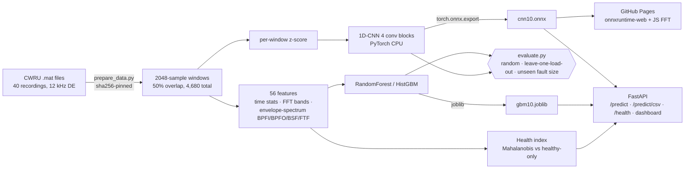

# VibeSense — bearing fault diagnosis & health index from vibration

**Diagnose rolling-bearing faults (inner race / ball / outer race, 3 damage sizes) from a 0.17 s vibration window, with an evaluation that shows how much of the usual "99 %+ on CWRU" is leakage.**

[](https://github.com/burlarakesh1458-sys/vibesense-predictive-maintenance/actions)

- **Live demo (runs in your browser, no server):** http://rakeshburla.dpdns.org/vibesense-predictive-maintenance/
- **Code:** https://github.com/burlarakesh1458-sys/vibesense-predictive-maintenance

The demo loads the exported 1D-CNN with **onnxruntime-web**. Pick one of 20 held-out windows (3 hp load, never seen in training) or upload a CSV; the page draws the waveform, the FFT spectrum and the envelope spectrum with the bearing defect-frequency markers, then shows the predicted fault, its confidence and all class probabilities.

## Architecture



## Quickstart

```bash
make setup          # runtime + test deps (serving needs no torch: models/ are committed)
make test           # 38 offline tests (node optional), no network, no keys
make demo           # FastAPI + dashboard on http://127.0.0.1:8000
curl -s localhost:8000/health
python -c "import json;xs=[float(v) for v in open('tests/fixtures/OR007_load3_0.csv').read().split()[1:]];print(json.dumps({'samples':xs}))" \
  | curl -s -X POST localhost:8000/predict -H 'content-type: application/json' -d @-
```

Reproduce every number (CPU only):

```bash
make setup-train    # + torch CPU, onnx, matplotlib
make all            # data -> evaluate -> deploy (+health, bench) -> figures -> demo-data
make web-parity     # optional: browser path in node (needs npm)
make demo-smoke     # optional: headless jsdom run of index.html with the real ONNX model
```

`make data` downloads the 40 files from the official CWRU site and verifies them against `data/cwru_sha256.json`; see [`data/PROVENANCE.md`](data/PROVENANCE.md).

## Results (measured)

All figures below are read from `reports/` (`metrics.json`, `runs/*.json`, `deploy_model.json`, `health_index.json`, `latency.json`), produced by the scripts named in each section. Accuracy / macro-F1 on the test side of each split; one seed (0).

### Three ways to split the same data

| split | what is shared between train and test | why it matters |
|---|---|---|
| **Random windows** | overlapping windows of the *same recording* | the protocol behind most "99–100 %" CWRU claims; leaky |
| **Leave-one-load-out** (`load0`…`load3`) | no recording; but the *same damaged bearing* run at another motor load | the split asked for in the brief: train 0–2 hp, test 3 hp |
| **Unseen fault size** (4-class) | no recording, no damaged bearing: train on 0.007" + 0.021" faults, test on 0.014" | closest to "a new bearing fails in the field" |

### 10 classes (normal + 3 fault types × 3 sizes) — `make evaluate`, `make deploy`

| model | random windows (leaky) | train 0–2 hp → test 3 hp | leave-one-load-out, mean of 4 |
|---|---|---|---|
| RandomForest, 56 features | 1.0000 / 1.0000 | 1.0000 / 1.0000 | 0.9998 / 0.9998 |
| HistGBM, 56 features | 0.9993 / 0.9993 | 0.9444 / 0.9415 | 0.9848 / 0.9841 |
| 1D-CNN, raw window | 1.0000 / 1.0000 | 0.9966 / 0.9966 | 0.9940 / 0.9940 |

### 4 classes (fault type only)

| model | random windows (leaky) | train 0–2 hp → test 3 hp | leave-one-load-out mean | **unseen 0.014" faults** |
|---|---|---|---|---|
| RandomForest | 1.0000 / 1.0000 | 1.0000 / 1.0000 | 1.0000 / 1.0000 | **0.3846 / 0.3750** |
| HistGBM | 1.0000 / 1.0000 | 0.9949 / 0.9923 | 0.9987 / 0.9981 | **0.4339 / 0.4663** |
| 1D-CNN | not run | 0.9957 / 0.9964 | not run | **0.4885 / 0.5333** |

Per-class recall on the unseen-size split (`reports/RESULTS.md`): every model keeps **Normal at 1.00 and Ball at ≥ 0.985**, but **Outer race falls to 0.00** for all three and Inner race to 0.00 (RF), 0.18 (GBM), 0.34 (CNN) — the 0.014" inner/outer faults are mostly predicted as *Ball*. Confusion matrices: `reports/figures/`.

**The honest takeaway:** on CWRU, a recording-level split (train 0–2 hp, test 3 hp) is nearly as easy as the leaky random split (RF 100 %, CNN 99.7 %), because the four loads of a fault class are the *same physical damaged bearing*. When the test bearing itself is new (0.014" damage), fault-type accuracy drops to **38–49 %**. Any CWRU number without a bearing-level split should be read as an upper bound.

### Exported models (what the API and demo run) — `make deploy`

| | value | source |
|---|---|---|
| CNN (ONNX) on held-out 3 hp, 10-class | acc 0.9966, macro-F1 0.9966 (only B021 below 1.0 recall: 0.966) | `reports/deploy_model.json` |
| GBM on held-out 3 hp, 10-class | acc 0.9444, macro-F1 0.9415 (IR014 recall 0.547) | `reports/deploy_model.json` |
| ONNX vs PyTorch, max abs probability diff | 4.8e-7 (label agreement 1.0 on all 1,170 test windows) | `reports/deploy_model.json` |
| ONNX size / parameters | 93,537 bytes / 23,194 parameters | `reports/deploy_model.json` |

### Health index (no fault labels) — `make deploy`

Mahalanobis distance of the 56-feature vector from **healthy windows at 0–2 hp only**; alarm at the 99th percentile of those healthy windows. Evaluated on 3 hp data:

| metric (3 hp test data) | value |
|---|---|
| AUROC healthy vs any fault | **1.000** |
| max HI of a healthy window / min HI of a faulty window | 12.5 / 83.0 |
| served threshold: cross-load p99 (fit on 2 training loads, scored on the 3rd, pooled) | 25.2 → **0 % false alarms, 100 % fault detection** |
| naive threshold: in-sample p99 of the fit windows | 8.48 → 62.4 % false alarms, 100 % detection |
| mean HI: healthy / 7 mil / 14 mil / 21 mil faults | 8.8 / 313.8 / 196.3 / 436.6 |

The naive threshold is the instructive failure: healthy data at an unseen load sits just outside the in-sample envelope, so 62 % of healthy windows would raise alarms. Calibrating the threshold across loads *inside the training set* fixes it without touching test data (`scripts/health_eval.py`). The HI is **not** a severity scale: 14-mil faults score lower than 7-mil ones.

### Latency per window (1 CPU thread, median of 300, shared 2-vCPU box) — `reports/latency.json`

| path | median | p95 |
|---|---|---|
| CNN, onnxruntime (Python) | 0.122 ms | 0.289 ms |
| full `/predict` call (resample check + CNN + 56 features + health index) | 2.15 ms | 9.14 ms |
| 56-feature extraction | 1.00 ms | 3.67 ms |
| features + HistGBM | 32.9 ms | 102.6 ms |
| CNN in onnxruntime-web WASM, node 22 (`reports/web_parity.json`) | 5.57 ms | – |

Load average was 9.5 on 2 vCPUs during the run, so absolute numbers are pessimistic and noisy (e.g. "GBM given features" measured 54 ms, *slower* than the end-to-end GBM row - contention, not a real difference). The CNN is ~270× faster than the GBM here because sklearn's per-call overhead over 2,000 trees dominates a single-row prediction.

## Design decisions

- **Window = 2048 samples (0.17 s)**: 5.9 Hz FFT resolution, enough to separate BPFO (~107 Hz), BSF (~141 Hz) and BPFI (~162 Hz) at 1730–1797 rpm, and ≥ 5 outer-race impacts per window.
- **Every recording cut to its first 121,000 samples** so all 10 classes have exactly 468 windows (the normal files are 2–4× longer). Macro-F1 is still reported.
- **Envelope analysis** (FFT-mask band-pass 2–5.5 kHz → Hilbert envelope → spectrum) is the classic bearing-diagnosis tool; the defect-frequency features use a fixed 1772 rpm reference with a ±4 % peak search, so the API never needs the shaft speed.
- **CNN input is per-window z-scored** (scale-invariant, identical in Python, ONNX and JS); wide 64-tap first kernel acts as a learned filter bank. Augmentation: random circular shift + light noise.
- **Served models are trained on 0–2 hp only**, so the 3 hp demo samples are genuinely unseen. The exported CNN is exactly the "train 0–2 hp → test 3 hp" CNN in the table (same data, recipe, seed; evaluated through ONNX).
- **Two inference paths in the browser vs server**: the page runs only the CNN (ONNX); the API adds the GBM and the health index. A JS DSP module (`demo/dsp.js`) is tested against the numpy code (`tests/test_js_parity.py`), and `scripts/web_parity.cjs` runs the exact browser path (dsp.js z-score → onnxruntime-web 1.22 WASM → `demo/assets/cnn10.onnx`) in node: **20/20 demo windows correct, same labels as PyTorch, max probability difference 7.5e-6** (`reports/web_parity.json`).
- **Health index instead of RUL**: CWRU has seeded faults, not run-to-failure histories, so remaining life cannot be measured on it. `vibesense.health.fit_trend` (log-linear HI trend → time to threshold) is included and unit-tested, but not evaluated (see Limitations).

## API

| method | path | body / params | returns |
|---|---|---|---|
| GET | `/health` | – | status, window size, classes, training split |
| POST | `/predict` | `{"samples": [≥2048 floats], "fs": 12000, "model": "cnn"\|"gbm"}` | label, fault type, size, confidence, all probabilities, health index, alarm flag, latency |
| POST | `/predict/csv` | multipart CSV (first numeric column), `?fs=&model=` | same |
| GET | `/` | – | the dashboard (same page as GitHub Pages) |

Inputs at other sample rates are linearly resampled to 12 kHz; only the first 2048 samples are scored.

## Limitations

- **Single rig, seeded faults.** CWRU faults are EDM-machined on one test rig. The model is not validated on any other machine, sensor mount or naturally developed fault; uploaded CSVs from other machines are out of distribution.
- **Only one seed per run**, on a shared, heavily loaded 2-vCPU box; no confidence intervals. Small differences (e.g. 0.9949 vs 0.9957) are not meaningful.
- **CNN not run for the 4-class random split or 4-class leave-one-load-out folds** (CPU budget); those cells say "not run". The 10-class CNN leave-one-load-out mean uses all four folds.
- **No remaining-useful-life evaluation.** The IMS/NASA run-to-failure bearing set was not downloaded (multi-GB on a shared box), so the trend/RUL code is tested only on synthetic data and no RUL accuracy is claimed.
- **Fault-size generalisation is poor (38–49 % fault-type accuracy on unseen 0.014" faults)**; no domain adaptation or physics-informed features beyond the envelope peaks were tried.
- **Docker image not built in this sandbox** (no Docker daemon); CI builds it and smoke-tests `/health` and `/predict`. The static page was checked headlessly (jsdom + real onnxruntime-web, `scripts/demo_smoke.cjs`), not in a real browser here.
- Latency is from a noisy shared VM, single-thread; the in-browser latency shown on the demo page is measured live on the visitor's device and is not in `reports/`.

## Repo layout

```
src/vibesense/   data.py features.py splits.py cnn.py health.py metrics.py predictor.py api.py
scripts/         prepare_data.py evaluate.py train_deploy.py health_eval.py bench_latency.py
                 make_figures.py build_demo_data.py web_parity.cjs demo_smoke.cjs
models/          cnn10.onnx gbm10.joblib health.json meta.json   (trained on 0-2 hp)
reports/         metrics.json runs/ deploy_model.json health_index.json latency.json web_parity.json RESULTS.md figures/
demo/ index.html static GitHub Pages demo (onnxruntime-web)
tests/           unit, API, ONNX-parity and JS-parity tests
```

Resume bullets: [RESUME_BULLETS.md](RESUME_BULLETS.md) · Data: [data/PROVENANCE.md](data/PROVENANCE.md) · License: MIT © 2026 Rakesh Burla.
Data courtesy of the Case Western Reserve University Bearing Data Center.
